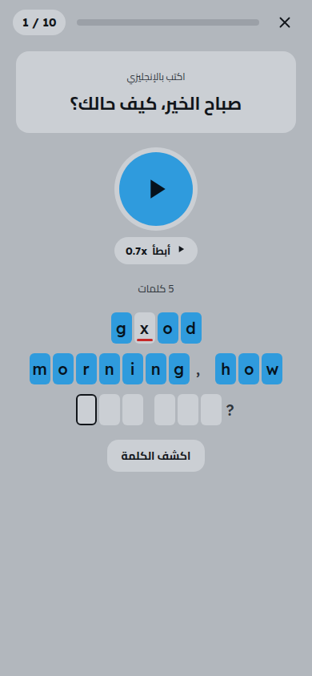
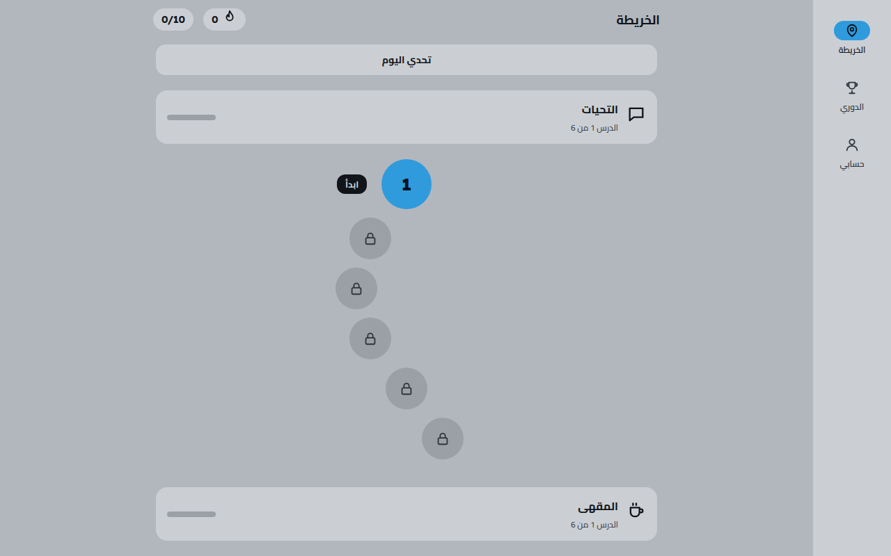

# English Dictation Bot

### تعلّم الإنجليزية بالاستماع والكتابة

ميني آب على تيليجرام للتدرّب على الإنجليزية بالإملاء. تسمع جملة وتكتب ما سمعته، ويحدّد التطبيق كل حرف خاطئ حتى تكتبها صحيحة. الدروس مقسّمة على مواقف من الحياة اليومية، ومعها هدف يومي ودوري أسبوعي وتحدٍّ يومي يشجّع المتعلّم على الاستمرار.

[البدء السريع](#البدء-السريع) · [الإعدادات](#الإعدادات) · [الترجمة](#الترجمة) · [مواصفات المنتج](docs/SPEC.md) · [English](README.md)





## ما الذي تحصل عليه

- تمارين إملاء قصيرة بصوت مسجّل لكل جملة ولكل كلمة
- خانة إدخال لكل كلمة، وتحديد الحروف الخاطئة أثناء الكتابة
- ترجمة تحت كل جملة ومعنى لكل كلمة
- دروس مقسّمة على مواقف يومية، من التحية إلى السفر
- فحص الإجابات على السيرفر، فلا يصل الحل إلى التطبيق قبل وقته
- هدف يومي وسلسلة أيام، ومراجعة متباعدة للأخطاء، ودوري أسبوعي وتحدٍّ يومي
- شارات وكلمات محفوظة وإحصائيات للتقدّم
- اشتراك Pro بنجوم تيليجرام، وإعلانات مكافأة اختيارية
- لوحة أدمن للمستخدمين والمدفوعات والإعدادات ومحتوى الدروس
- اتجاه من اليمين لليسار ومن اليسار لليمين، مع اختصارات لوحة المفاتيح على الكمبيوتر

## البدء السريع

تحتاج إلى Docker وتوكن بوت من [BotFather](https://t.me/BotFather) وعنوان HTTPS عام. تيليجرام لا يتصل إلا بـHTTPS، فللتجربة المحلية ضع التطبيق خلف نفق أو reverse proxy.

```bash
cp .env.example .env              # fill in BOT_TOKEN, PUBLIC_URL, POSTGRES_PASSWORD and the secrets
docker compose up --build         # starts the app and PostgreSQL
```

يطبّق التطبيق الـmigrations ويسجّل الويبهوك عند التشغيل.

المستودع فيه الكود دون الدروس. ولّدها بمفاتيح Gemini الخاصة بك (`GEMINI_API_KEY_1` و`GEMINI_API_KEY_2` وهكذا في `.env`):

```bash
# write the sentences, translations and word meanings for every situation
docker compose run --rm app eng content generate --all

# record the missing sentence and word audio
docker compose run --rm app eng content audio
```

الخطة المجانية في Gemini تحدّ طلبات الصوت لكل مفتاح في اليوم، فقد يستغرق تسجيل كل الصوت عدة أيام. إضافة مفاتيح، أو مفتاح مفعّل عليه الدفع، يسرّع العملية.

### بدون Docker

تحتاج إلى Rust (نسخة stable، إصدار 2024) وPostgreSQL 16 و`ffmpeg`.

```bash
cp .env.example .env              # set DATABASE_URL to your PostgreSQL database
cargo run --release -- serve      # always build with --release
cargo run --release -- content generate --all
cargo run --release -- content audio
```

## الإعدادات

كل شيء يأتي من متغيرات البيئة، والملف `.env.example` يسردها كلها.

| المتغير | الغرض |
|---|---|
| `BOT_TOKEN` | توكن بوت تيليجرام |
| `PUBLIC_URL` | عنوان HTTPS العام للميني آب |
| `BIND_ADDR` | العنوان الذي يستمع عليه السيرفر |
| `DATABASE_URL` | رابط الاتصال بـPostgreSQL |
| `WEBHOOK_PATH` و`WEBHOOK_SECRET` | جزء مسار الويبهوك والهيدر السري |
| `ADSGRAM_REWARD_SECRET` و`ADSGRAM_BLOCK_ID` | إعلانات المكافأة، وتتوقف ما دام الـblock id فارغًا |
| `ADMIN_IDS` و`ADMIN_USERNAME` | أرقام الأدمنز على تيليجرام، وحساب التواصل للدفع اليدوي |
| `CHALLENGE_CHANNEL_ID` | القناة التي يُنشر فيها ملخص التحدي اليومي |
| `DATA_DIR` و`WEB_DIR` | مجلد ملفات الصوت ومجلد الميني آب |
| `GEMINI_API_KEY_<n>` | مفاتيح Gemini، تُستخدم بالتناوب |

الحدود اليومية والأسعار وقواعد النقاط محفوظة في جدول `settings`. تعدّلها لوحة الأدمن ويسري التعديل دون إعادة تشغيل.

## الترجمة

الواجهة والبوت متاحان اليوم بالعربية والإنجليزية. إضافة لغة تحتاج إلى ملفي نصوص وسطر واحد في قائمة، دون أي تعديل في الكود، والخطوات في [TRANSLATING.md](TRANSLATING.md). تصحيح الترجمات الموجودة مرحَّب به بنفس القدر.

محتوى الدروس (ترجمات الجمل ومعاني الكلمات) يُولَّد بالعربية حاليًا.

## كيف هو مبني

برنامج Rust واحد اسمه `eng` يخدم ويبهوك البوت وواجهة JSON والميني آب. أوامره: `serve` و`content generate` و`content audio` و`content voices` و`webhook set`.

```
src/
  http/        axum router, authentication, one file per API area
  telegram/    webhook handlers, bot texts, payments
  exercise/    tokenizer, checker, scoring (pure functions)
  content/     sentence generation, validation, audio, admin tasks
  gemini/      key pool, text and speech clients, audio cleaning
  jobs.rs      scheduled work: leagues, daily challenge, purge, reminders
migrations/    sqlx migrations
web/           the Mini App, plain HTML, CSS and JS with no build step
web/i18n/      Mini App strings and the language list
texts/         bot messages per language
```

كل الحالة الدائمة في PostgreSQL. الحالة المؤقتة (المحاولات المفتوحة ومعرّفات تحديثات الويبهوك وكريديت الإعلانات غير المستخدم) تُمسح بعد يوم على الأكثر. يصف [docs/SPEC.md](docs/SPEC.md) سلوك المنتج، ويسجّل [docs/DECISIONS.md](docs/DECISIONS.md) أسباب القرارات الرئيسية.

## التطوير

```bash
cargo fmt --all --check
cargo clippy --all-targets --release -- -D warnings
cargo test --release
```

الاختبارات التي تحتاج قاعدة بيانات تعمل حين يشير `TEST_DATABASE_URL` إلى قاعدة PostgreSQL مخصصة للتجارب. كل اختبار ينشئ schema مؤقتًا ويحذفه بعد انتهائه.

## المساعدة والمساهمة

المشكلات والأفكار تذهب إلى متتبّع المشكلات. يذكر [CONTRIBUTING.md](CONTRIBUTING.md) الفحوصات قبل أي pull request، ويشرح [TRANSLATING.md](TRANSLATING.md) الترجمة، وتُبلَّغ المشكلات الأمنية كما في [SECURITY.md](SECURITY.md).

## الترخيص

منشور بموجب [رخصة MIT](LICENSE)
