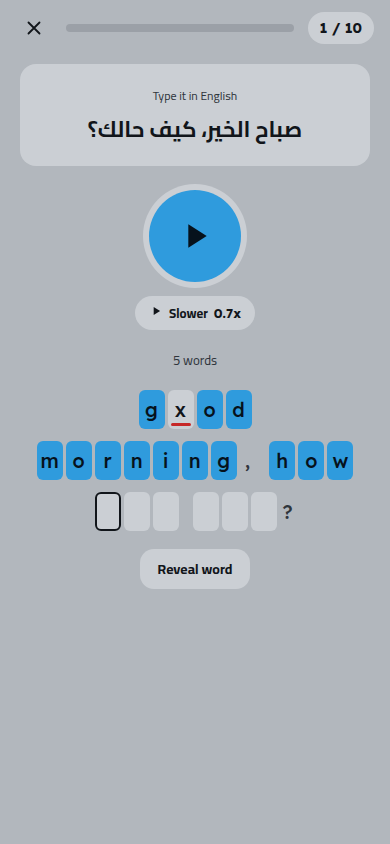
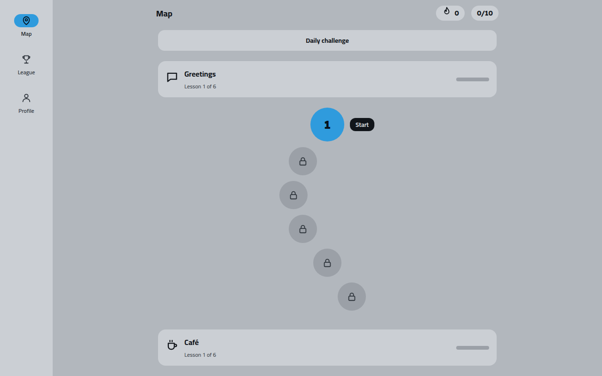

# English Dictation Bot

**English** · [العربية](README.ar.md)

### Learn English by listening and typing

English Dictation Bot is a Telegram Mini App for practicing English through dictation. The learner hears a sentence, types what they hear, and the app marks every wrong letter until the sentence is right. Lessons follow everyday situations and grow from short phrases to full sentences, so listening and spelling improve together.



## What it does

Each exercise plays a sentence and shows its translation above one input box per word. The server checks the letters as they are typed and underlines the wrong ones, and it never sends the answer before the sentence is solved. Once solved, every word can be played again, looked up and saved. [Read how it works](docs/how-it-works.md)



Learners keep coming back through:

- A daily goal and streak
- Review of past mistakes after 1, 3 and 7 days
- Weekly leagues in seven tiers, and a daily challenge with its own leaderboard
- Badges, saved words and progress statistics
- Evening reminders from the bot, which the learner can turn off

The Mini App works on phones and desktops, in right-to-left and left-to-right languages, with keyboard shortcuts on a computer.

## Pro membership

Free learners get 10 sentences a day. Pro raises that to 50 and adds free word reveals, access to every lesson, streak freezes and detailed statistics. Pro is paid with Telegram Stars, monthly or yearly, or granted by an admin after a manual payment. Prices and limits are settings the admin can change. [Read the full Pro details](docs/pro.md)

## Run your own

The app is one Rust service with a PostgreSQL database, packaged as a Docker image. It needs a Telegram bot token, Gemini API keys to generate the lessons and their audio, and a public HTTPS address, either a domain of your own or the free address of your hosting platform.

[The deployment guide](docs/deploy.md) covers a VPS with Docker, Railway, and other platforms such as Render and Fly.io. For a quick look on your own machine:

```bash
cp .env.example .env              # fill in the values
docker compose up --build         # starts the app and PostgreSQL
```

## Translations

The interface and the bot speak Arabic and English. A new language needs two text files and one line in a list, with no code changes. [Read the translation guide](TRANSLATING.md)

The lesson translations and word meanings are generated in Arabic at the moment.

## Contributing

Bug reports, ideas and pull requests are welcome. [The contributing guide](CONTRIBUTING.md) lists the checks to run before a pull request.

## References

- [How it works](docs/how-it-works.md)
- [Pro membership](docs/pro.md)
- [Deployment](docs/deploy.md)
- [Translating](TRANSLATING.md)
- [Contributing](CONTRIBUTING.md)
- [Security policy](SECURITY.md)
- [Product specification](docs/SPEC.md)
- [Design decisions](docs/DECISIONS.md)
- [Changelog](CHANGELOG.md)
- [MIT License](LICENSE)
